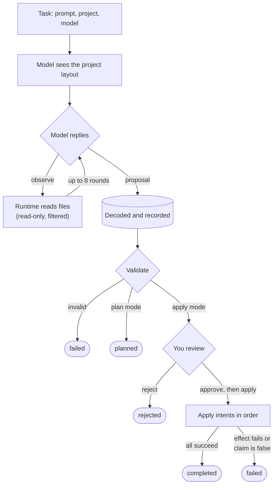

# Current

**A deterministic runtime for AI workflows.**

Agents propose changes. The runtime validates them, records them, and
decides whether they happen.

```text
agent     proposes
runtime   validates and records
you       approve or reject
runtime   applies and records
```

The agent never writes a file or runs a command itself. Nothing touches
your project until you approve its proposal and ask for it to be applied,
and every step is kept in a hash-chained log.

> **Status: early.** One machine, one user, a local project. **Not a
> sandbox**: an approved command runs with your privileges. See the
> [threat model](docs/threat_model.md).

[Why](#why) · [Quickstart](#quickstart) · [How it works](#how-it-works) ·
[Intents](#intents) · [CLI](#cli-reference) · [Configuration](#configuration) ·
[Security](#security) · [Status](#what-exists-today) ·
[Design](#design-principles) · [Roadmap](#roadmap)

---

## Why

Most agent tools let the model edit files and run commands directly. That is
convenient, and it puts side effects inside a probabilistic system: you find
out what the agent did by looking at what changed.

Current turns that around. Because the agent can only *describe* changes, you
can:

- **read the whole change before it happens**: every diff, every new file,
  every command and its arguments;
- **approve or reject it as a unit**, and record who did and why;
- **check the agent's claims**: a claim cites the intent that proves it, and
  a claim that doesn't hold fails the workflow;
- **inspect everything afterwards**: what the model was asked, what it looked
  at, what it said (byte for byte), and what each effect produced.

| Concern | Typical agent runtime | Current |
|---|---|---|
| File edits | Agent edits directly | Agent proposes a diff; the runtime applies it after approval |
| Commands | Agent invokes a shell | Agent requests an executable and arguments; runs only after approval |
| What the agent read | Whatever it opened | Recorded with the proposal, filtered by a read policy |
| State | Ad hoc workspace state | Derived from an append-only, hash-chained event log |
| Audit | Chat transcript | Every event, plus content-addressed artifacts for every input and output |

---

## Quickstart

**Requirements**

- Elixir 1.18+ on Erlang/OTP 27+
- `patch` and `bash` on your `PATH` (used when applying)
- An API key for OpenAI (`OPENAI_API_KEY`), Anthropic (`ANTHROPIC_API_KEY`), or both

**1. Start the runtime.** Current is a long-running node; `current` is a
client of it. The server prints every request and every commit to the log as
it happens. Ctrl-C stops it.

```sh
ANTHROPIC_API_KEY=sk-ant-... bin/current-server
```

**2. Build the CLI** in another terminal, and check it can reach the runtime.

```sh
make client
./current status
# the models your API keys give you
./current models
```

**3. Ask for a plan.** Nothing is executed. The model is shown your
project's layout, can ask to read files, and replies with a proposal, which
is validated and recorded.

```sh
./current plan "add input validation to the signup form" \
  --model anthropic:claude-opus-5-5 --dir path/to/project
```

**4. Run, review, approve, apply.** `run` does the same in apply mode and
stops when the proposal is waiting for approval. Each step is separate, and
nothing touches the project until `apply`.

```sh
./current run "add input validation to the signup form" \
  --model anthropic:claude-opus-5-5 --dir path/to/project

# every diff and file, as Markdown (or --json)
./current review <proposal-id>

./current approve <proposal-id> -m "looks right"

# applies the intents, and follows the workflow to the end
./current apply <proposal-id>
```

**5. Inspect what was recorded.**

```sh
# the workflow's events, in log order (a task id works too)
./current events <workflow-id>

# every intent, and what the model looked at first
./current proposal <proposal-id>

# exact bytes, e.g. a proposed diff
./current artifact <artifact-id>
```

Ids can be shortened to any unique prefix of 4 or more hex digits.

---

## How it works

A proposal is a list of typed *intents*: "patch `lib/signup.ex` with this
diff", "run `mix test`", "claim the tests pass, because that command exits
0". The runtime decodes and validates it, records it, and waits. Once you
approve it and ask for it to be applied, a small, trusted interpreter
carries out the intents one at a time and records every result.



Every step in this diagram is recorded as an event. Rounded boxes are where
a workflow ends.

> **AI workflows as pure state transitions, with effects at the edge.**

The model is probabilistic, and so is the world it acts on: files change,
commands fail. What Current makes deterministic is the bookkeeping. Workflow
state is a pure function of an append-only event log, every decision is in
that log, and replaying the log always yields the same state.

### Producing a proposal

1. A **task** is submitted with a prompt, a project directory and a model.
   The directory is resolved once to its real path and recorded; every path
   the agent names is checked against it from then on.
2. The model is given the project's **layout**: file paths and sizes, no
   contents. Dependencies, build output, VCS directories and `.env*` files
   are left out.
3. The model may reply with an **observe** request: up to 20 `read_file`,
   `glob` or `grep` intents. The runtime runs them read-only, under the same
   path checks as applied intents plus the read policy, and asks again with
   the results. It may do this up to 8 times, within 400 KB of results in
   total; a file over 200 KB is not shown.
4. The model replies with a **proposal**: the intents it wants carried out.
   Its exact reply is stored, whatever it contains.
5. The proposal is **decoded** into typed intents (the wire contract is
   [docs/wire_schema.md](docs/wire_schema.md), and
   `priv/schema/proposal_response.schema.json`), every path is made absolute
   against the project, and the proposal is **validated**: paths stay inside
   the project, referenced files exist, claims cite earlier intents whose
   results they can be checked against.

Validation answers "is this proposal well-formed and in bounds right now?",
not "will it apply cleanly?". The project can change between validation and
apply, and a valid proposal can still fail: a patch that no longer matches,
a file that now exists, a command that exits non-zero. Those failures are
caught and recorded at apply time.

Producing a proposal is bounded: each model call by
`llm_proposal_timeout_ms`, and the whole conversation by the task's own
`--timeout-minutes` or, by default, 10 minutes.

### Applying it

A proposal from `run` waits for a decision. `approve` records it; `reject`
ends the workflow. `apply` is a separate step: it starts the interpreter,
which re-checks every path against the filesystem as it is *now* (following
symlinks), then carries out the intents in order. The re-check narrows the
window for a path to escape the project; it does not close it (see T2 in the
[threat model](docs/threat_model.md)). The first failure, or the
first claim that doesn't hold, stops it and fails the workflow. Effects are
not rolled back.

If the runtime stops mid-apply, the workflow is failed on restart rather
than resumed: an effect that may or may not have happened is never repeated.

### Lifecycle

```text
created → planning → validating → waiting_for_approval
   plan mode:   → planned
   apply mode:  → approved → applying → assembling_result → completed
                → rejected
any stage:      → failed      (production, validation or an effect failed)
                → abandoned   (no further automatic progress is possible)
```

### The record

Everything that happens is an **event**, appended to a write-ahead log on
disk. Each commit carries the hash of the one before it, and the log
refuses to start if the chain is broken. In-memory views of tasks,
proposals and workflows are rebuilt from the log on every start.

Contents (diffs, file snapshots, command output, the model's raw replies)
are stored as **artifacts**: immutable blobs named by their SHA-256. Events
refer to artifacts by id.

---

## Intents

| Intent | What it does when applied | Allowed in `observe` |
|---|---|---|
| `read_file` | Reads a file and stores its contents | yes |
| `glob` | Lists files matching a relative pattern | yes |
| `grep` | Finds lines containing a literal string in listed files | yes |
| `write_file` | Creates a new file; fails if it already exists | |
| `file_patch` | Applies a unified diff with `patch --fuzz=0`; stores before and after | |
| `delete_file` | Deletes a file; stores its contents first | |
| `run_command` | Runs an executable with arguments in the project directory; stores stdout, stderr and exit code | |
| `claim` | Checks a statement against an earlier intent's result (`exit_code_equals`, `match_count_equals`, `match_count_greater_than`) | |
| `report` | A summary for the reader; no effect | |

The exact JSON is specified in [docs/wire_schema.md](docs/wire_schema.md).

---

## CLI reference

| Command | What it does |
|---|---|
| `current plan <prompt> --model <m> [--dir <d>] [--timeout-minutes <n>]` | Produce and validate a proposal. Nothing is executed. |
| `current run <prompt> --model <m> [--dir <d>] [--timeout-minutes <n>]` | The same in apply mode; stops when the proposal waits for approval. |
| `current review <proposal-id> [--json] [--max-lines <n>] [--raw]` | A proposal with its diffs and file contents. `--json` emits `current.review/v1`. |
| `current approve <proposal-id> [-m <message>]` | Record approval. Nothing is applied. |
| `current reject <proposal-id> [-m <message>]` | Turn a proposal down; the workflow ends. |
| `current apply <proposal-id>` | Apply an approved proposal, and follow it to the end. |
| `current events <workflow-or-task-id>` | A workflow's events, in log order. |
| `current proposal <proposal-id>` | A proposal in full: intents, observations, artifacts. |
| `current artifact <artifact-id>` | An artifact's exact bytes, for piping (e.g. into `git apply`). |
| `current models` | Models discovered from the configured providers. |
| `current status` | Whether the runtime is up, and how it is configured. |

`--model` is required and has no default; use a name `current models`
prints, e.g. `openai:gpt-5.6`. `--timeout-minutes` is a whole number from
1 to 60.

The CLI holds no state. Interrupt it at any point; the workflow carries on
in the runtime, and `current events <id>` picks it up again. Exit codes are
0 on the expected outcome, 1 on failure and 2 on a usage error.

---

## Configuration

### Environment

| Variable | Read by | Meaning |
|---|---|---|
| `OPENAI_API_KEY` | runtime | Enables `openai:*` models |
| `ANTHROPIC_API_KEY` | runtime | Enables `anthropic:*` models |
| `CURRENT_DATA_DIR` | runtime (prod) | Where the log and artifacts live (default `./_data`) |
| `CURRENT_NODE` | CLI | Runtime node name (default `current@localhost`) |
| `CURRENT_COOKIE` | CLI | Erlang cookie (default: `~/.erlang.cookie`) |

Models are discovered once, when the runtime starts. A provider without a
key, or one that doesn't answer, contributes no models, and a task naming
one of its models is refused.

### Application config (`config/*.exs`)

| Key | Default | Meaning |
|---|---|---|
| `data_dir` | `"./_data"` | Log in `consensus/`, artifacts in `artifacts/` |
| `llm_proposal_timeout_ms` | `240_000` | Bound on one model call |
| `llm_task_timeout_ms` | `600_000` | Default bound on producing one proposal (all calls and reads) |
| `commit_log_segment_bytes` | 64 MiB | Log segment size before rolling over |
| `proposal_builder` | `Current.LLMProposalBuilder` | What produces proposals |
| `effect_applicator` | `Current.EffectApplicator` | What applies intents |
| `model_catalog_clients` | OpenAI, Anthropic | Providers asked for models |

---

## Security

Current narrows what an agent can do *without you*. It does not limit what an
approved proposal can do. In short:

- **Nothing an agent proposes is executed without explicit authorization.**
  Its output is parsed into typed intents; nothing is applied without an
  approval and a separate `apply`. What happens once you authorize it is
  bounded only by what the proposal contains.
- **Paths are confined** to the project directory, checked lexically at
  validation and again, following symlinks, immediately before each effect.
- **What the model sees is filtered** by name: dependencies, build output,
  VCS directories and `.env*` files are never listed or shown. Other secrets
  in your project (keys, credential files) are *not* recognised.
- **`run_command` is not confined.** Arguments are passed without shell
  interpretation, but the command itself runs as you, with your environment
  (including your API keys), network access and no time limit. Approving a
  command is approving arbitrary code: `mix test` runs whatever the tests
  contain.
- **The control plane is Erlang distribution.** Anyone who can reach the node
  and has the cookie has full control of the runtime, not just the CLI's
  commands.
- **The log is tamper-evident to the runtime, not to an attacker.** The hash
  chain catches corruption; it is not signed.

The full analysis, with what is mitigated, what is not, and how to run
Current more safely, is in [docs/threat_model.md](docs/threat_model.md).
Please report vulnerabilities privately rather than in a public issue.

---

## What exists today

| | Status |
|---|---|
| Plan, run, review, approve, reject, apply from the CLI | ✅ |
| OpenAI and Anthropic models, chosen per task | ✅ |
| Model asks to see files before proposing (observe) | ✅ |
| Typed wire contract with a JSON Schema | ✅ |
| Validation, with path confinement checked twice | ✅ |
| Hash-chained, segmented write-ahead log; state rebuilt on start | ✅ |
| Content-addressed artifacts for every input and output | ✅ |
| Verified claims: a false claim fails the workflow | ✅ |
| Per-task timeout on producing a proposal | ✅ |
| Policies (e.g. a command allowlist) | planned |
| `simulate`: apply in a throwaway copy first | planned |
| Sandboxed command execution, and a timeout on commands | planned |
| Atomic apply (all intents or none) | planned |
| An API other than Erlang distribution (HTTP, MCP) | planned |
| Listing and searching workflows | planned |
| Log snapshots (today every commit is replayed on start) | planned |

---

## Design principles

**Pure core, impure edge.** Workflow state is a pure function of the event
log (`WorkflowReducer`). Side effects live in one module
(`EffectApplicator`), small enough to read.

**Intents over actions.** Agents describe intended changes. They never
execute them.

**Event sourcing by default.** Task submitted, proposal produced,
validated, approved, each effect applied or failed, workflow completed:
every step is an event, and state is derived from them.

**Deterministic orchestration around a non-deterministic world.** The
model's reply, the filesystem and command results all vary. Each is
captured as it happens: the reply byte for byte, effect results as
artifacts. The state machine and recovery are deterministic functions of
what was recorded; validation and effects, which look at the live
filesystem, are not.

**Never guess after a crash.** A workflow interrupted while applying is
failed, not resumed: an effect that may already have happened is not
repeated.

**Minimal trusted surface.** The code that touches the world is small,
explicit, and tested.

---

## Roadmap

**Next**

- command policy (allowlist), and a timeout and output cap on commands
- `simulate`: apply to a temporary copy, show the result, discard it
- atomic apply: apply to a copy, promote only if every intent succeeds
- an HTTP/JSON API and an MCP server, so other agents and tools can drive Current
- `current list`: workflows by status

**Later**

- sandboxed interpreters (containers or similar)
- signed log heads, and snapshots so startup doesn't replay everything
- branch/worktree support
- workflow definitions with typed contracts between steps
- distributed execution (the log is already behind a consensus interface)

---

## Contributing

Contributions are welcome, especially in:

- interpreters and sandboxing
- policy design
- the intent algebra and wire contract
- event model, reducers and projections
- test harnesses and replay tooling
- clients: HTTP, MCP, editors

`mix test` runs the suite. If your change alters what an event stores,
bump the event's version and add an `upcast` clause; recorded logs must keep
loading.

---

## License

MIT

