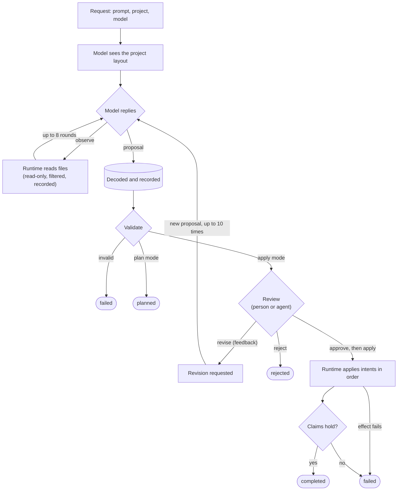

# Current

**A runtime for agent-written changes you can trace to the request behind
them, replay on another machine, and verify.**

Everyone building with coding agents is adding logs of what the agent did.
A log answers *what happened*. It doesn't answer the questions that matter
once agent-written code ships:

- **Why was this change made?** Which request asked for it?
- **Who authorized it?**
- **Can someone else check it?** Take the record somewhere else, replay it,
  and get the same answer?

Most agents can't answer these, because the model calls tools from inside
its reasoning loop. Deciding and doing are one event, and the only record
is a transcript written about the work after the fact.

Current is built so the record *is* the work. The agent can only propose.
The runtime does everything else, and every step it takes is an event in
a hash-chained commit log that every state is derived from.

| | What it means | How Current does it |
|---|---|---|
| **Provenance** | Every change ties back to the request and the authorization behind it, not just to the agent action | Request, proposal, approval and effect are linked events in one log |
| **Reproducibility** | Move the record to another machine, replay it, get the same result | State is a pure fold over the log; all content is content-addressed |
| **Verifiability** | You can tell whether the history was altered | Each commit carries the SHA-256 of the one before; startup verifies the whole chain |
| **The agent never mutates state** | The model proposes; only the runtime acts | A closed intent language, applied by one small interpreter |
| **A gate before anything happens** | A person, or another agent, checks the proposal before it is applied | Approval is its own recorded event; `apply` is a separate step |

All of this comes from applying event sourcing, CQRS, immutability and
pure reducers to agent workflows (see [Architecture](#architecture)).

> **Status: early.** One machine, one user, a local project. **Not a
> sandbox**: an approved command runs with your privileges. See the
> [threat model](docs/threat_model.md).

[The agent proposes](#the-agent-proposes-the-runtime-acts) ·
[Provenance](#provenance-from-a-change-back-to-the-request) ·
[Reproducibility](#reproducibility-replay-the-record-anywhere) ·
[Verifiability](#verifiability-a-hash-chained-history) ·
[Architecture](#architecture) · [Quickstart](#quickstart) ·
[How it works](#how-it-works) · [Intents](#intents) · [CLI](#cli-reference) ·
[HTTP API](#http-api) · [MCP](#mcp) · [Configuration](#configuration) ·
[Security](#security) · [Status](#what-exists-today) · [Roadmap](#roadmap)

---

## The agent proposes, the runtime acts

In a typical agent, a tool call *is* the action: the file is written the
moment the model decides to write it. In Current, the model's output is a
**proposal**, a list of typed intents:

> "in `lib/signup.ex`, replace this text with that"; "run `mix test`";
> "claim the tests pass, because that command exits 0"

A proposal does nothing on its own. Between it and your project, the
runtime:

1. **decodes** the model's reply, which is untrusted bytes, into a closed
   set of intent types. Anything outside it is rejected, not interpreted;
2. **validates** it: paths confined to the project, files exist, every
   edit matches exactly, claims cite earlier intents they can be checked
   against;
3. **waits for a decision.** A proposal is reviewed as a unit
   (`current review`, or `--json` for a machine reader) and approved,
   rejected, or sent back with feedback. The reviewer can be a person or
   another agent: each decision is an API call, recorded as its own event
   with the reviewer's metadata. A workflow can hold several proposals, and
   a decision must name the latest. Sending one back produces a
   replacement, up to a bound (10 revisions by default);
4. **applies** it, in a separate step, with a small trusted interpreter
   that re-checks every path immediately before touching it and records
   every result;
5. **checks the outcome itself.** Claims are evaluated against recorded
   results, and a claim that doesn't hold fails the workflow. The agent
   doesn't grade its own work.

The model also never reads your project directly. It sees the layout
(names and sizes), and every file it asks to see goes through path
confinement and a read policy, within fixed budgets, and is recorded.

---

## Provenance: from a change back to the request

Because the runtime is the only thing that acts, and records each step
before taking the next, every change sits at the end of an explicit chain:

```text
TaskCreated                  the request: prompt, model, project, submitted_at
└─ WorkflowCreated
   └─ ProposalProduced       intents, what the model read first, its raw reply
      └─ ProposalValidated
         ├─ ProposalRevisionRequested   who asked for what change; loops back to
         │  └─ ProposalProductionStarted → ProposalProduced (revision 1, revises
         │     the one above) → ProposalValidated → ... up to the bound
         └─ ProposalApproved     who, when, with what message
            └─ EffectApplicationStarted
               ├─ EffectApplied      an edit: file before and after
               ├─ EffectApplied      a command: exit code, stdout, stderr
               ├─ EffectApplied      a claim: verified, and against what
               └─ WorkflowCompleted
```

So for any change you can answer, from the record alone and without the
model:

| Question | Answered by |
|---|---|
| Who asked for this, and what exactly did they ask? | `TaskCreated`: the prompt, model and project |
| Why does the agent say it's needed? | The proposal's justification and claims |
| What did the model look at before deciding? | Each observation, with its reason and the exact bytes it was shown |
| What did the model actually say? | Its raw reply, stored byte for byte |
| Who authorized it, and when? | `ProposalApproved` and its metadata |
| What did the reviewer ask to change, and what came of it? | `ProposalRevisionRequested` and the next proposal's `revision` and `revises` |
| What exactly changed? | Each effect's result: file before and after, command output |
| Did it do what the agent claimed? | Each claim's verification and evidence |
| What *didn't* happen, and why? | Rejections, validation failures, failed effects, each with a reason |

```sh
current events <workflow-id>     # the chain, in log order (a task id works too)
current proposal <proposal-id>   # intents, claims, and what the model read first
current artifact <artifact-id>   # exact bytes: a file before an edit, command output, a raw reply
```

**Authorization is recorded, not enforced by identity.** Current
guarantees that nothing is applied without an approval event in the chain,
followed by a separate apply, and the reducer enforces that at commit
time. Who may approve is for a layer in front of it: approvals enter
through one route (`POST /v1/proposals/:id/approve`), where a gateway can
authenticate the caller and write verified identity into the approval's
metadata. Today `reviewed_by` is whatever the client sends.

---

## Reproducibility: replay the record anywhere

The commit log and the artifact store are the whole of Current's state.
Nothing else is persisted, and everything the runtime shows you (tasks,
proposals, workflows) is rebuilt from them. So the record is portable:
copy the data directory to another machine, and replaying it gives the
same history.

There are two levels of replay, and it matters which one you mean.

**Replaying the record (works today).** Every workflow state is a pure
function of its events (see [the reducer](#the-reducer)). Every piece of
content those events refer to is an immutable artifact named by its
SHA-256. Replaying the same log, anywhere, gives the same states, the
same accepted transitions and the same rejections, and every artifact
can be checked against its own name. Point `CURRENT_DATA_DIR` at a copy
and the runtime rebuilds it on start. (Starting the runtime also resumes
or fails workflows that were still in progress, which appends new
events. Copy a record whose workflows have finished.)

**Re-executing the proposals (planned).** This is the stronger check:
take the approved proposals, apply them to the same starting tree on
another machine, and compare. Current records what makes that
comparison exact. Each edit stores the file's before and after content
hashes, and each command stores its exit code and output, so a re-run can
be diffed against the original byte for byte. Edits replay
deterministically. Commands are as reproducible as the environment
they run in, and a difference shows up as a different artifact hash. A
`current export` / `current replay` pair to do this is on the
[roadmap](#roadmap).

---

## Verifiability: a hash-chained history

The commit log is a hash chain, the structure blockchains use to make
history tamper-evident (without mining, tokens or multi-party consensus).

```text
commit 1              commit 2                commit 3
┌────────────────┐    ┌──────────────────┐    ┌──────────────────┐
│ index: 1       │    │ index: 2         │    │ index: 3         │
│ previous: nil  │◀───│ previous: H(c1)  │◀───│ previous: H(c2)  │◀── head
│ events: [...]  │    │ events: [...]    │    │ events: [...]    │
└────────────────┘    └──────────────────┘    └──────────────────┘
                 H(c) = SHA-256 of term_to_binary(commit, [:deterministic])
```

Changing any byte of any past commit changes its hash and breaks every
link after it, so **the head hash fingerprints the entire history**. It
also covers the content: events refer to file contents, edits, command
output and model replies by their SHA-256 artifact ids, so those are
committed to as well.

- **Only valid successors are written.** A commit must have the next index
  and the head's hash as `previous_hash`, or it is refused and nothing is
  written.
- **Durable before acknowledged.** A commit is fsynced before anyone hears
  of it.
- **Verified on every start.** Every link is re-checked, across segments.
  A gap, a broken link or corrupt bytes stop the runtime from starting,
  naming the file. It refuses to serve a history it can't vouch for.
- **Closed segments are immutable**, and opened read-only.

Commit hashes currently use `:erlang.term_to_binary/2` with the
`:deterministic` option. This makes term encoding deterministic within the
supported Erlang term format, but does not guarantee byte-for-byte identical
encoding across OTP versions. Cross-version verification needs a stable,
versioned canonical encoding (see the [roadmap](#roadmap)).

**What this proves today:** integrity. The history the runtime replays is
exactly the history it wrote, unbroken and in order. **What it doesn't
yet:** authenticity to an outsider. Commits aren't signed, so someone
who can write the data directory can rewrite history and recompute every
hash. Signing the head, or publishing it somewhere the writer can't reach,
closes that gap: once a third party holds a head hash, every request,
approval and effect beneath it is verifiable against it. That, and
re-verifying artifact hashes on read, are on the [roadmap](#roadmap).

---

## Architecture

Current applies functional-programming and distributed-systems patterns
to agent workflows. Each provides one of the properties above.

| Pattern | In Current | Gives you |
|---|---|---|
| **Event sourcing** | Every step is a typed, past-tense, versioned event. The log is the only source of truth | Provenance, replay |
| **CQRS** | Commands (`submit`, `approve`, `revise`, `apply`) go through `Current.API` and become proposed events. Queries read projections (`WorkflowStore`, `ProposalStore`, `TaskStore`) built from committed events | Reads never mutate; writes are only events |
| **Pure reducer** | `WorkflowReducer.apply_event/2`: state × event → state, or refusal | Deterministic state; one definition of what is allowed |
| **Immutability** | Events are never edited or deleted; corrections are new events. Artifacts never change | A history worth verifying |
| **Content addressing** | Artifacts are named by the SHA-256 of their bytes | Deduplication, and content that checks itself |
| **Hash-chained WAL** | Each commit carries the previous commit's hash | Tamper evidence |
| **Interpreter pattern** | Intents are data in a closed algebra; `EffectApplicator` is the one module that interprets them against the world | The agent can't act; a minimal trusted surface |
| **Pure core, impure edge** | Model calls and effects run at the edge and come back as events | Effects are captured, not hidden |
| **Schema evolution by upcasting** | Old events are migrated on read by pure, versioned functions, never rewritten on disk | Old logs keep replaying through new code |
| **Consensus interface** | Commits are ordered through `Current.Consensus.propose/1`; single-node today | A path to a replicated log |

### The reducer

At the center is one pure function:

```elixir
WorkflowReducer.apply_event(workflow | nil, event)
  :: {:ok, workflow} | {:error, {:invalid_transition, status, event_type}}

WorkflowReducer.replay(events)   # a fold of apply_event over the log
```

It reads no clock, touches no disk and calls no model. Every timestamp
comes from the event. It *is* the workflow state machine, an explicit
table of `(status, event) → status` clauses, and anything not in the
table is refused:

| Rule | Enforced by |
|---|---|
| Nothing applies without approval | `EffectApplicationStarted` is accepted only from `:approved` |
| A plan can never be applied | `ProposalApproved` is accepted only for `mode: :apply` |
| One decision per proposal | approval, rejection and a revision request are accepted only from `:waiting_for_approval` |
| Only the latest proposal can be decided | approval, rejection, a revision request and `EffectApplicationStarted` must name the workflow's most recent proposal, else `{:stale_proposal, given, current}` |
| Revisions are bounded | a revision request is refused with `{:revision_limit_reached, max}` once `max_revisions` (recorded on `WorkflowCreated`, default 10) are used |
| Terminal means terminal | nothing moves a `completed`, `planned`, `rejected`, `failed` or `abandoned` workflow |

The same function is used at every layer, so the layers can't disagree.
`EventStore` replays a workflow's events plus each new one **at commit
time**, so an event the reducer refuses never becomes canonical, and of
two racing approvals only one is accepted. The API runs it as an early
check before proposing. The projections are the reducer applied to the
stream, and recovery replays through it on restart. Because acceptance
is itself a pure function of the events already accepted, replaying the
log reproduces every rejection as well as every state.

### The orchestrator is a policy, not a script

`WorkflowOrchestrator` maps each committed event to the next event it
proposes (`WorkflowCreated → ProposalProductionStarted`, `ProposalProduced
→ ProposalValidated | ProposalValidationFailed`, ...). It never changes
state directly, and acts only on what is committed. Model calls and effects
run in separate processes, and their results come back as messages that
become events. Nothing an effect does counts until it is an event.

### Never guess after a crash

On restart, every workflow is rebuilt from the log and resumed from what
the log says. A workflow interrupted mid-apply is failed rather than
resumed, because an effect that may already have happened is never
repeated. One that crash-loops is retried with backoff, then abandoned on
the record.

---

## Quickstart

**Requirements**

- Elixir 1.19+ on Erlang/OTP 27+
- `git`
- `bash` on your `PATH` (used when running commands)
- An API key for OpenAI or Anthropic, or both, exported as `OPENAI_API_KEY`
  or `ANTHROPIC_API_KEY`. The runtime won't start without at least one.

**1. Get the code** and check out a release. Releases are git tags;
`git tag --list` shows them all.

```sh
git clone https://github.com/<you>/current.git
cd current
git checkout v0.1.0      # a detached HEAD at that release; `git switch main` to go back
```

**2. Install dependencies and compile.**

```sh
mix deps.get
mix compile
```

**3. Start the runtime.** A long-running server with an HTTP API (on
`127.0.0.1:4000` by default). It prints every request and every commit as
it happens.

```sh
bin/current-server
```

To poke at the runtime from Elixir instead, start it in IEx:

```sh
iex -S mix
```

This starts the same runtime and HTTP API with a shell attached, but it
doesn't print requests and commits.

**4. Build the CLI** in another terminal. It is a client of the API.

```sh
make client
./current help
./current status
./current models     # the models your API keys give you
```

**3. Make a request.** `run` stops when the proposal is waiting for
review. Nothing has touched the project.

```sh
./current run "add input validation to the signup form" \
  --model anthropic:claude-opus-5-5 --dir path/to/project --timeout-minutes 5
```

**4. Review, then approve, revise or reject.** Each decision is a separate,
recorded step.

```sh
./current review <proposal-id>                    # every edit, file and command, as Markdown
./current approve <proposal-id> -m "looks right"  # recorded; nothing is applied yet
./current revise <proposal-id> -m "keep X, change Y"  # send it back and follow the new proposal
./current reject <proposal-id> -m "wrong approach"    # turn it down
./current apply <proposal-id>                     # apply, verify its claims, follow to the end
```

Approving, rejecting and applying only work on proposals from `current run`.
A proposal from `current plan` is for review only. `-m` is optional for
`approve` and `reject` but required for `revise`. Ids can be shortened to a
unique prefix of at least 4 hex digits, as `review` prints them.

**5. Trace it.**

```sh
./current events <workflow-id>
./current proposal <proposal-id>
./current artifact <artifact-id>
```

`plan` instead of `run` produces and validates a proposal that can never
be applied. Ids can be shortened to any unique prefix of 4 or more hex
digits.

---

## How it works



Every step is an event. Rounded boxes are where a workflow ends.

### Producing a proposal

1. A **task** is submitted with a prompt, a project directory and a model.
   The directory is resolved once to its real path and recorded.
2. The model is given the project's **layout**: paths and sizes, no
   contents. Dependencies, build output, VCS directories and `.env*` files
   are left out.
3. The model may reply with an **observe** request: up to 20 `read_file`,
   `glob` or `grep` intents, each with a reason. The runtime runs them
   read-only, under path confinement and the read policy, and asks again
   with the results. Up to 8 rounds, 400 KB of results in total, 200 KB
   per file.
4. The model replies with a **proposal**. Its exact reply is stored as an
   artifact, whatever it contains.
5. The proposal is **decoded** into typed intents
   ([wire contract](docs/wire_schema.md)), every path is made absolute
   against the project, and it is **validated**.

Validation answers "is this well-formed and in bounds right now?", not
"will it apply cleanly?". The project can change before apply, and those
failures are caught and recorded then. Producing a proposal is bounded by
`llm_proposal_timeout_ms` per call and the task's `--timeout-minutes`
(default 10) overall.

### Applying it

`apply` starts the interpreter. It re-checks every path against the
filesystem as it is *now* (following symlinks), then carries out the
intents in order. The first failure, or the first claim that doesn't
hold, stops it and fails the workflow. Effects are not rolled back. The
re-check narrows the window for a path to escape the project but doesn't
close it (T2 in the [threat model](docs/threat_model.md)).

### Lifecycle

```text
created → planning → validating → waiting_for_approval
   plan mode:   → planned
   apply mode:  → approved → applying → assembling_result → completed
                → rejected
                → revision_requested → planning → validating → waiting_for_approval
                  (bounded; each pass adds a proposal to the workflow)
any stage:      → failed      (production, validation or an effect failed)
                → abandoned   (no further automatic progress is possible)
```

### Three primitives

| Primitive | When | Role | More |
|---|---|---|---|
| Intent | Before execution | A proposal, as data | [intent.md](docs/intent.md) |
| Event | After execution or decision | A fact | [event.md](docs/event.md) |
| Artifact | Throughout | Immutable bytes, named by their SHA-256 | [artifact.md](docs/artifact.md) |

> *Intents propose change. Artifacts hold bytes. Events record fact.
> State is derived from the event log.*

---

## Intents

| Intent | What it does when applied | Allowed in `observe` |
|---|---|---|
| `read_file` | Reads a file and stores its contents | yes |
| `glob` | Lists files matching a relative pattern | yes |
| `grep` | Finds lines containing a literal string in listed files | yes |
| `write_file` | Creates a new file; fails if it already exists | |
| `edit_file` | Replaces exact text (`old_string` → `new_string`); must match once unless `replace_all`; stores before and after | |
| `delete_file` | Deletes a file; stores its contents first | |
| `run_command` | Runs an executable with arguments in the project; stores stdout, stderr and exit code | |
| `claim` | Checks a statement against an earlier intent's result (`exit_code_equals`, `match_count_equals`, `match_count_greater_than`) | |
| `report` | A summary for the reader; no effect | |

---

## CLI reference

| Command | What it does |
|---|---|
| `current run <prompt> --model <m> [--dir <d>] [--timeout-minutes <n>]` | Make a request; stops when the proposal waits for review. |
| `current plan <prompt> --model <m> [--dir <d>] [--timeout-minutes <n>]` | Produce and validate a proposal that can never be applied. |
| `current review <proposal-id> [--json] [--max-lines <n>] [--raw]` | A proposal with its edits, files and commands. `--json` emits `current.review/v1`. |
| `current approve <proposal-id> [-m <message>]` | Record approval. Nothing is applied. |
| `current reject <proposal-id> [-m <message>]` | Turn a proposal down; the workflow ends. |
| `current revise <proposal-id> -m <feedback>` | Send a proposal back. The agent produces a replacement; follows the workflow until it waits for review again. Must name the latest proposal. |
| `current apply <proposal-id>` | Apply an approved proposal, verify its claims, follow it to the end. |
| `current events <workflow-or-task-id>` | The chain: a workflow's events, in log order. |
| `current proposal <proposal-id>` | A proposal in full: intents, claims, observations, artifacts. |
| `current artifact <artifact-id>` | An artifact's exact bytes, for piping. |
| `current models` | Models discovered from the configured providers. |
| `current status` | Whether the runtime is up, and how it is configured. |

`--model` is required; use a name `current models` prints.
`--timeout-minutes` is 1 to 60. The CLI holds no state: interrupt it at any
point and the workflow carries on in the runtime. Exit codes are 0 on the
expected outcome, 1 on failure and 2 on a usage error.

---

## HTTP API

The CLI does nothing a script, or another agent, can't: it calls these
routes.

| Route | Does |
|---|---|
| `POST /v1/tasks` | Submit a task: `{"prompt", "model", "dir", "mode", "timeout_ms"}` → `202 {"task_id"}` |
| `GET /v1/workflows/:id` | A workflow's status and events (a task id or unique prefix works) |
| `GET /v1/workflows/:id/activity` | What the model has asked to see so far (`?epoch=&after_seq=`) |
| `GET /v1/proposals/:id` | A proposal in full |
| `GET /v1/proposals/:id/review` | The `current.review/v1` document (`?max_lines=&raw=true`) |
| `POST /v1/proposals/:id/approve` | Record approval: `{"message", "reviewed_by"}` |
| `POST /v1/proposals/:id/reject` | Turn the proposal down |
| `POST /v1/proposals/:id/revise` | Send it back: `{"feedback", "reviewed_by"}`. `409 stale_proposal` if a newer proposal exists (`details.current_proposal_id`); `409 revision_limit_reached` when none are left |
| `POST /v1/proposals/:id/apply` | Start applying an approved proposal |
| `GET /v1/artifacts/:id` | An artifact's exact bytes |
| `GET /v1/models`, `GET /v1/health` | The model catalog; whether the runtime is up |

Errors are `{"error": {"code", "message"}}` with a matching status. The
API does no authentication (see [Security](#security)). Every route checks
`Host` and, when present, `Origin` before reading the body. Loopback Host
values must use the configured runtime port; deployments behind another
hostname must add its exact authority to `http[:allowed_hosts]`.

---

## MCP

Current also exposes a Model Context Protocol (MCP) server at `POST /mcp`,
using Streamable HTTP and protocol version `2025-06-18`. It exposes tools
for submitting tasks, inspecting workflows and proposals, reviewing and
retrieving artifacts, approving, rejecting, requesting revisions, applying
proposals, listing models, and checking runtime health.

The MCP endpoint uses the same `Current.API` and runtime invariants as the
CLI and HTTP API. Tasks return immediately with a task id; clients poll
`get_workflow` for progress. It is stateless and tools-only: no sessions,
resources, prompts, server-initiated streams, or batch requests. `GET /mcp`
is not supported.

**MCP does not authenticate callers.** Anyone who can reach the endpoint can
submit, approve, and apply proposals. Keep it on loopback or behind a trusted
gateway that enforces access control. Like every route, it checks `Host` and
`Origin`; it additionally checks `MCP-Protocol-Version` and `Content-Type`.
These are not substitutes for authentication. See [Security](#security) and the
[threat model](docs/threat_model.md).

---

## Configuration

### Environment

| Variable | Read by | Meaning |
|---|---|---|
| `OPENAI_API_KEY` | runtime | Enables `openai:*` models |
| `ANTHROPIC_API_KEY` | runtime | Enables `anthropic:*` models |
| `CURRENT_DATA_DIR` | runtime (prod) | Where the log and artifacts live (default `./_data`) |
| `CURRENT_HTTP_PORT` | runtime | Port of the HTTP API (default `4000`) |
| `CURRENT_HTTP_IP` | runtime | Address the HTTP API binds (default `127.0.0.1`) |
| `CURRENT_URL` | CLI | Where the CLI finds the runtime (default `http://127.0.0.1:4000`) |

### Application config (`config/*.exs`)

| Key | Default | Meaning |
|---|---|---|
| `data_dir` | `"./_data"` | Log in `consensus/`, artifacts in `artifacts/` |
| `allowed_commands` | `[]` | Executables `run_command` may run; empty denies all. The configured list is included in the model prompt. Not a sandbox |
| `llm_proposal_timeout_ms` | `240_000` | Bound on one model call |
| `llm_task_timeout_ms` | `600_000` | Default bound on producing one proposal |
| `commit_log_segment_bytes` | 64 MiB | Log segment size before rolling over |
| `proposal_builder` | `Current.LLMProposalBuilder` | What produces proposals |
| `effect_applicator` | `Current.EffectApplicator` | What applies intents |
| `http[:allowed_hosts]` | `[]` | Exact Host authorities allowed in addition to loopback hosts on the configured port, for example `current.internal:443` |
| `mcp[:allowed_origins]` | `[]` | Exact browser origins allowed on every route in addition to loopback origins |
| `mcp[:allow_loopback_origins]` | `true` | Whether browser origins on `localhost`, `127.0.0.1`, and `[::1]` are accepted |
| `model_catalog_clients` | OpenAI, Anthropic | Providers asked for models |

---

## Security

Current controls *when* an agent's proposal takes effect and records
everything about it. It does not limit *what* an approved proposal can do.

- **Nothing an agent proposes runs without approval** and a separate
  `apply`, enforced by the reducer at commit time.
- **Paths are confined** to the project, checked lexically at validation
  and again, following symlinks, just before each effect.
- **What the model sees is filtered** by name (dependencies, build output,
  VCS directories, `.env*`). Other secrets in the project are *not*
  recognised.
- **`run_command` is restricted by an executable allowlist, not sandboxed.**
  Commands are denied by default. Allowed executables run with the runtime's
  privileges and environment, including filesystem and network access.
  Arguments are not restricted, so allowing interpreters or shells can permit
  arbitrary code execution.
- **The HTTP API is unauthenticated.** It listens on 127.0.0.1. Every route
  validates `Host` and browser `Origin` to prevent DNS rebinding, but these
  checks do not authenticate non-browser clients. Restrict who can reach it
  with a gateway, proxy or network policy; anyone who can reach it can
  approve and apply.
- **The log is tamper-evident to the runtime, not yet to an attacker.**
  See [Verifiability](#verifiability-a-hash-chained-history).

Full analysis: [docs/threat_model.md](docs/threat_model.md). Please report
vulnerabilities privately.

---

## What exists today

| | Status |
|---|---|
| Request, review, approve, reject, apply from the CLI or HTTP | ✅ |
| Bounded revision loop: a reviewer sends a proposal back with feedback | ✅ |
| Request, proposal, approval and effects linked in one log | ✅ |
| What the model read, and its raw replies, recorded with the proposal | ✅ |
| Verified claims: a false claim fails the workflow | ✅ |
| Pure reducer enforcing every transition at commit time | ✅ |
| Hash-chained, segmented WAL, verified on every start | ✅ |
| State and rejections rebuilt deterministically from the log | ✅ |
| Content-addressed artifacts for every input and output | ✅ |
| Versioned events with upcasting | ✅ |
| OpenAI and Anthropic models, chosen per task | ✅ |
| MCP tools over stateless Streamable HTTP (`POST /mcp`) | ✅ |
| `current export` / `current replay`: re-execute on another machine and diff | planned |
| `current verify`: check the chain and every artifact, print the head hash | planned |
| Signed or externally anchored log heads | planned |
| Approval policy hook / authenticated approvers | planned (layered on top) |
| Command executable allowlist (deny by default) | ✅ |
| Command timeout and output cap | planned |
| Atomic apply, `simulate` | planned |

---

## Roadmap

**Next**

- `current export` and `current replay`: bundle a workflow's events and
  artifacts, re-apply on another machine against the same starting tree,
  and diff every artifact hash
- `current verify`: re-check the chain and every artifact against its
  name, and print the head hash
- an approval policy hook (N approvers, an approver other than the
  requester), where an ACL layer plugs in
- command timeout and output cap
- atomic apply, and `simulate` in a throwaway copy

**Later**

- signed log heads, and publishing head hashes externally
- a stable, versioned canonical encoding for commit hashes (today they use
  `:erlang.term_to_binary([:deterministic])`, which does not guarantee
  identical bytes across OTP versions)
- log snapshots, so startup doesn't replay everything
- sandboxed interpreters
- a replicated log behind the existing consensus interface

---

## Contributing

Contributions are welcome, especially in:

- replay, export and verification tooling
- approval policy and access control on top of the approval record
- interpreters and sandboxing
- the intent algebra and wire contract
- event model, reducers and projections

`mix test` runs the suite. If your change alters what an event stores,
bump the event's version and add an `upcast` clause; recorded logs must
keep loading.

---

## License

MIT


